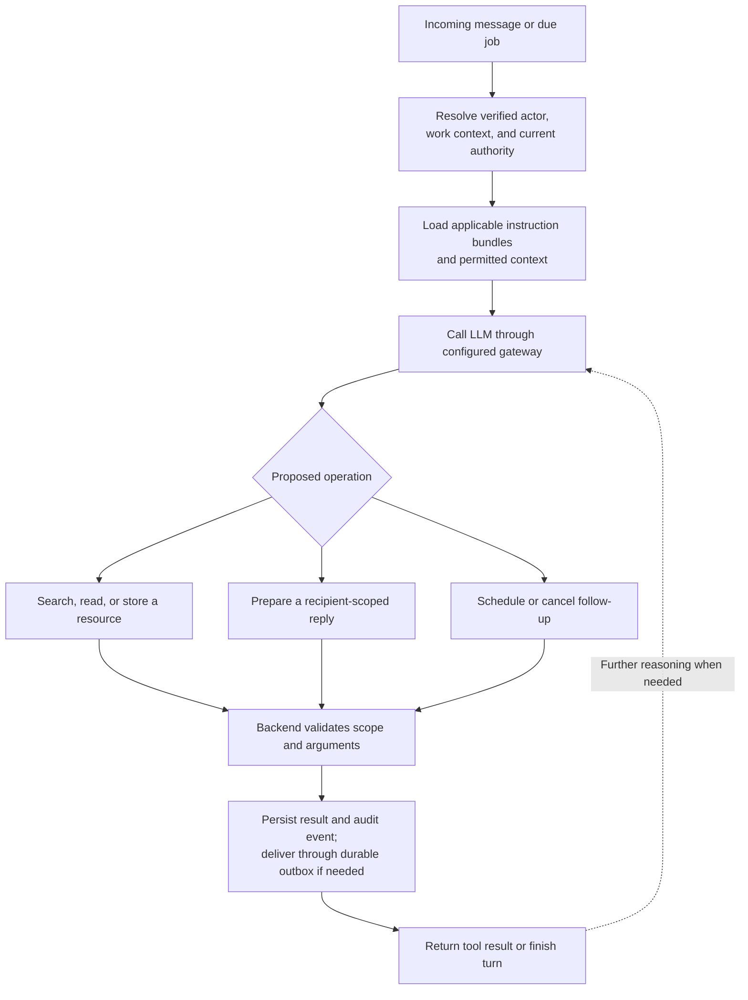

# Carbon

A domain-neutral conversation harness running on a Reefy device. Carbon connects participants, messages, resources, LLMs, bounded application functions, and durable scheduled work. Domain knowledge and conversational strategy come from live, permissioned instructions and reference material.

## Status

[Self-managed participant profiles](docs/participant-profiles.md) provide versioned directory descriptions and public profile search for registered participants, with separately authorized outbound messaging. Profiles are self-reported; vetting and trust levels remain separate future work.

Carbon shows WhatsApp typing while processing and sends one brief update after 25 seconds. See [processing feedback and timeouts](docs/processing-feedback.md).

Current implemented scope: [reviewed approval-admin management](docs/admin-management.md), private text conversations, [versioned private notes](docs/note-revisions.md) with owner-only edits and readable history, immutable uploaded files, logical folders with inherited read grants, reviewed moves, group administration and executable 2PR. JPEG/PNG/WebP understanding uses the selected vision-capable model. Authorized files and notes can be sent back to the requesting participant. Keyword search finds accessible saved information; pending-review discovery finds request IDs. See [search and reviews](docs/search-and-reviews.md). PDFs (including scans) are interpreted by the selected model, and supported audio is transcribed by xAI through the proxy. Carbon has no local PDF/OCR/audio parser. [Scoped coordination](docs/scoped-coordination.md) supports standing group-to-group authority, isolated pair contexts, mutually readable resources and fresh quoted uploads without routine approval prompts. Authorized attachments can be delivered to the other participant through a durable queue. Live instruction bundles and video understanding remain planned. Experimental durable tasks and Rust-owned scheduling are implemented behind `experimental_tasks`; see [task boundaries](docs/durable-tasks.md). See [attachments and folders](docs/attachments-folders.md). See [implementation status](docs/implementation-status.md) and [permission pilot](docs/permissions-pilot.md). The [Aventura Bay example](docs/aventura-bay-example.md) remains a future configuration rather than business logic in the core.

See [testing](docs/testing.md) for synthetic and optional real-model validation.

## Architecture decision index

See [accepted decisions and implementation readiness](docs/architecture-decisions.md) for the consolidated contract, remaining design gates and implementation order; [alternatives researched](docs/architecture-alternatives.md) records why competing storage/access designs were not selected. Target storage paths are under `/data/state` and `/data/content`; the [first-release guide](docs/first-release.md) is authoritative for implemented behavior.

## What we are building

Carbon receives a message from a verified participant, assembles permitted context, calls a configured model, validates requested operations, and records/delivers the result. The LLM decides what to ask next, which accessible information to retrieve, whom to propose contacting, and when a follow-up is useful.

Carbon does not need to understand “contractor,” “AC repair,” or “community rules.” It sees participant IDs, groups, resources, conversations, and operations. Those domain terms occur in profiles, notes, prompts, and documents.

Carbon does not classify business intent or run built-in business workflows. The LLM interprets messages, chooses relevant participants from permitted profiles, asks questions and proposes generic operations. Rust validates IDs, scope, resource provenance, audiences, capabilities, budgets and state transitions. A coordination scope describes those bounds, not a business process. There is no `start_quote`, `contractor`, `AC_problem` or business-stage switch in the core.



### Core primitives

| Primitive | Core responsibility |
|---|---|
| Participant | Stable opaque ID and verified channel-address bindings |
| Group | Explicit membership and resource audience |
| Conversation | Participants, messages, attachments, delivery state |
| Resource | Content, owner, parent folder, version, source references, access grants |
| Task | Durable objective, linked conversations/resources, lifecycle and budgets; created at the LLM's request |
| Run | One bounded processing attempt triggered by a message or scheduled event |
| Message | Authenticated sender, content, attachment references and delivery state |
| Bundle | Live versioned collection of resources and authorized instructions |
| Scheduled job | Trigger, creator/execution identity, context, cancellation and run state |
| Action | Validated tool operation and recorded execution outcome |
| Permission grant / approval request | Deterministic authority and exact protected-change review |

Domain entities can be represented as resources with content-specific fields. The core need not implement separate contractor, appliance, quote, or repair-order tables. If a future use case needs a specialized transactional integration, add a reviewed capability rather than making the LLM generate executable code.

## Deterministic core and LLM judgment

“Carbon” describes the boundary: probabilistic interpretation and planning run inside deterministic authority, persistence, and execution rules.

| Hardcoded Rust mechanisms | LLM responsibilities |
|---|---|
| Verified identity and current access checks | Interpret ordinary participant language |
| Tool schemas, allowed operations, argument validation | Resolve intent and propose tool calls |
| 2PR eligibility, canonical change summaries, exact response parsing | Explain changes and ask clarifying questions |
| Transactions, revision checks, audit events, durable jobs/outbox | Draft content and propose next steps/follow-ups |
| Recipient-scoped context and dispatch checks | Reason over the permitted supplied material |

Model output is a proposal, not proof of identity, permission, consent, or successful execution. Deterministic checks constrain actions but do not establish that an LLM correctly understood the participant. The exact 2PR review makes protected proposals inspectable before execution. Core rules can use validated configuration values; “hardcoded” means Rust enforces the mechanism rather than asking the model to enforce it.

## Initial protected configuration

Use a small, schema-validated YAML file (or equivalent JSON) provisioned through trusted device setup. It describes storage locations, initial participants/groups/folders, initial “true admins” eligible for 2PR, policy defaults, and WhatsApp connection settings. This configuration is outside participant-editable bundles and the model's filesystem/tool surface.

Illustrative design only; this is not an implemented configuration schema:

```yaml
schema_version: 1
storage:
  database: /data/state/carbon.sqlite
  content_repository: /data/content
bootstrap:
  participants:
    - id: participant_owner
      enrollment_ref: owner_invitation
    - id: participant_reviewer
      enrollment_ref: reviewer_invitation
  true_admins: [participant_owner, participant_reviewer]
  groups:
    - id: members
      members: [participant_owner, participant_reviewer]
  folders:
    - id: shared_reference
      owner: participant_owner
      readers: [members]
      writers: [participant_owner]
two_pr:
  required_distinct_reviewers: 1
  requester_may_approve: false
  issuer_may_approve: false
  expires_after_minutes: 60
  protected_operations:
    - group.create
    - group.membership.change
    - group.capability.change
    - administrative_grant.change
    - approval_policy.change
whatsapp:
  adapter: whatsapp-rust
  session_directory: /data/state/whatsapp
llm:
  gateway: reefy-llm-proxy
  # Resolve the private endpoint through Reefy integration.
  # Any Carbon-owned gateway credential belongs in /data/state/secrets.
```

“True admin” is an explicitly provisioned approval capability, not a claimed name or automatic access to every private resource. Participant enrollment must verify channel bindings before activation; plain configuration names/phone numbers are not proof of identity. Two initial admins allow independent review when either requests a protected change. An ordinary participant may submit only proposals allowed by their proposal capability; review eligibility alone is not grant/execute authority. The operation must have a principal authorized for its full resulting scope plus the required distinct review; permissions from different principals are not implicitly combined. The exact issuer/reviewer capability matrix remains a schema gate.

Keep Carbon-owned credentials in protected files under /data/state/secrets, referenced by config, so Reefy backs them up together with Carbon state. Never put credentials in the repository, prompts, or bundles. Rust reads them directly; no model-accessible shell is involved.

Bootstrap entries initialize SQLite once with a recorded configuration version. Restarts must not reapply stale memberships, recreate removed grants, or overwrite live folders. SQLite then remains the source of truth for live identities, memberships, resources and 2PR policies. Provisioned infrastructure settings remain configuration; later administrative policy changes use 2PR under the existing policy. A device-owner recovery/configuration migration is an explicit audited operation, never a silent restart override. Invalid startup configuration fails validation rather than widening access.

## Abuse protection and later internet research

Carbon must enforce administrator-configurable per-participant and installation limits before expensive work: ingress, model calls/tokens, concurrent work, scheduling, outbound fan-out, uploads and retained storage. Stable participant UUIDs and backend-assigned budget owners prevent relinking or background jobs from resetting allowances. Limits and usage are durable SQLite state; prompts cannot override them.

See [proposed pilot defaults and administration](docs/abuse-and-integrations.md). Future autonomous internet research uses narrow search/page-reading integrations with bounded network access, approved query disclosure and untrusted-result handling. It does not add a general HTTP, browser or shell tool. Implementation is deferred; the capability and accounting contracts are planned now. The [architecture review](docs/architecture-review.md) records remaining contracts before schema freeze and autonomous operations.

## Runtime and scheduling

The implemented [concurrent processing lanes](docs/concurrency.md) default to four active Carbon turns, serialize each participant, and keep scheduling and delivery independent of model waits. Configure `model_concurrency` (1–16) in the application JSON.

Use a Rust application with an async runtime such as Tokio. Prefer lightweight async tasks on a bounded thread pool for messaging, model requests, and due jobs; do not allocate a thread/process per scheduled item. Async tasks can share runtime threads ([Tokio documentation](https://tokio.rs/tokio/tutorial/spawning)). CPU-heavy or blocking work needs a bounded worker pool so it does not stall async I/O.

Avoid operating-system cron, shell scripts, and model-controlled processes. Jobs are structured database records, never command strings. The efficiency benefit comes from bounded concurrency and avoiding process startup; actual latency/resource use must be measured. Threads/tasks share a process and are not tenant security boundaries. Rust does not replace authorization or OS/container isolation.

### Durable scheduler

Expose narrow functions such as `schedule_followup`, `list_jobs`, and `cancel_job`. Start with one-time schedules; later add validated recurring expressions and event triggers. Even if recurrence uses cron-like syntax, it is parsed as scheduling data and never written to an OS crontab.

A job records its ID, creator, execution identity/delegation, work-context ID, trigger/timezone, instruction resource/version, retry/deadline policy, and status. The backend derives identity/authority; the LLM cannot choose a more privileged principal.

- Persist jobs in SQLite. Keep the authoritative queue on disk, not in sleeping futures.
- A timer wakes the dispatcher; atomically claim due jobs with leases and bounded concurrency. Recover expired claims after a crash.
- At execution and again before side effects, recheck participant/group membership, resource permissions, active bundles, delegation expiry, and job cancellation.
- Load current authorized context. A stored prompt or summary cannot restore revoked data access. If referenced resources are no longer allowed, stop or rebuild from permitted sources.
- Record attempts and outcomes; use idempotency keys and an outbox. Delivery is not inherently exactly-once; reconcile ambiguous external results before retrying.
- Specify missed-run behavior, recurrence timezone/DST behavior, retry backoff, and duplicate prevention. Coalesce overdue repetitions rather than flooding recipients after an outage.
- Apply per-participant/work-context limits and cancellation controls. Scheduling permission is not blanket authority for future external actions.

A work context may receive events from several participants. Each run records the verified event sender, execution principal, sponsoring delegation, allowed recipients, budget owner and expected work-context/cancellation revision. Those identities are distinct and never unioned into broader authority. A reply can trigger only the scope authorized by its existing delegation, not arbitrary work billed to the sponsor. Per-context version checks reject stale completions after cancellation or intervening decisions; one active turn per participant alone does not serialize a shared work context. Scheduled descendants inherit remaining cumulative limits and expiry, never a fresh unlimited budget.

When due, a job wakes an LLM turn that can inspect replies and decide whether a follow-up remains useful. There is no continuous model loop while waiting.

## Participants and identity

Detailed design: [identity, relinking and permission consistency](docs/identity-permissions.md). Use a random UUIDv4 allocated on first admitted live contact; scoped unique channel bindings prevent duplicate identities. The first contact creates no group membership or administrative authority. Phone relinking/recovery preserves that UUID and requires verified endpoints plus protected 2PR.

Use permanent internal IDs. WhatsApp numbers/provider identifiers are replaceable verified channel bindings, not folder names or durable personal identity.

After validating a live event from the selected linked-device transport, the channel adapter maps the provider sender to the participant. For the future official adapter, require webhook validation first. Phone-based Cloud API schemas may supply `messages[].from` and contact `wa_id`; verify the selected API version's identifier contract before implementation. The receiving business phone-number ID identifies our endpoint, not the sender.

For number changes, authorize the request from an existing trusted session or established recovery path, verify the new endpoint, then atomically replace the binding. Retire old channel sessions and resolve pending delivery against the current authorized endpoint. Do not inherit the old endpoint's messaging window. No resources/history need to move.

Names, claimed addresses, or number possession alone must not silently merge participants or recover another person's history. Shared accounts, conflicting bindings, and group membership require explicit handling.

## Deterministic access and sharing

**Use one content rule: a resource may be sent to a recipient who currently has read access to it.** There is no separate content “forward” permission and no LLM sensitivity classifier deciding which readable files are shareable.

Read permission is audience-specific: Carbon acting for X can read X's private resource, but that does not mean Y can read it. Delivery also requires normal authority to contact that recipient and channel-policy compliance.

### Resource permissions

- New uploads/messages are owned by the verified sender. Configured channel/conversation intake rules attach their permitted use and audience bounds; otherwise they are private. An enabled generic coordination scope can instantiate bounded context audiences automatically. Meaning inferred by the model is not authority to relabel private resources.
- Resources have explicit owner and grants to participant/group IDs. Use `read`, `write`, and `manage_access`; changing ownership is explicit.
- Folder grants may be inherited. For a simple first version, use additive grants with no hidden deny/override precedence; private children belong outside broadly shared folders.
- Owners cannot accidentally publish existing private children by a silent folder move or broad grant: preview the affected resources and require the authorized access change.
- “Everyone” means a named audience/group, not the internet or every installation.
- Resource IDs and paths do not grant access. Apply the same checks to search, snippets, attachment delivery, histories, caches, extraction derivatives, and jobs.
- Bundle contents, notes, model responses, and uploaded documents cannot grant access or add group members. An explicit message from an authorized participant may request these operations through backend-validated administration functions.

Configured intake rules and verified channel/conversation context establish permitted input use. For an uncorrelated message, the LLM may propose a context/scope ID only from scopes already invocable by the actor. Rust validates actual source IDs, provenance and audience bounds; scope selection cannot widen an input's original permitted use. Interpreting “keep this private” or ambiguity in prose is model behavior, while structured privacy flags and access checks are deterministic. The model may ask factual disambiguation questions without starting a permission flow.

### Disclosure checks apply to all outputs

Recipient-scoped generation also applies to shared file creation/updates, names/descriptions, bundle edits, copied summaries, scheduled-job instructions and external query arguments. A private run cannot copy its input into a shared resource merely because its execution identity has write permission there. Runtime provenance covers all supplied context, not just sources the model cites. Stage restricted output privately or regenerate under the destination's permitted audience; publishing requires authority over every restricted source being released. See [information flow and publication](docs/identity-permissions.md#information-flow-and-publication).

### Recipient-scoped generation

Before drafting an outbound message, fix its recipients and assemble context from only resources readable by every recipient and permitted by the acting delegation. This includes messages, attachment text, conversation summaries, memory, and bundle material—not just explicit file reads.

A private planning turn may discover that a message is needed, but its free-form draft or private summary must not be handed to a less-privileged outbound turn. Pass a validated action request and permitted resource references; build the outward-facing model context afresh.

Generated text and derivatives retain the source references and audience scope of that run. Recheck permissions/source versions before dispatch; if they changed, cancel or regenerate from currently permitted sources. Do not rely on the LLM to report all sources it saw: the runtime records supplied/retrieved context.

This is generic access enforcement, not a domain-specific assessment of what is secret. It limits exposure but cannot guarantee that an LLM will never hallucinate sensitive-looking information.

### Publishing a shorter summary

No new publication approval is needed when all inputs are already readable by the target audience and the existing delegation covers the action. If the original must remain private and an owner wants to release only a shorter version:

1. Create a draft in that owner's private scope (LLM assistance is allowed).
2. The owner selects/approves the concrete version and audience. If the draft also derives from another party's restricted sources, require that party's applicable publication authority; ownership of the draft does not confer it.
3. Publish it as a separate resource with an explicit read grant.
4. Outbound generation uses that published resource, not its private source.

Carbon does not automatically infer that summarization or redaction makes content public. Publication is an ordinary owner-authorized sharing operation. Private drafts keep inherited source restrictions until this explicit publication. Revocation stops future access/delivery; it cannot retract already delivered copies from recipients.

For example, a broadly readable reference folder can be quoted to its members directly. A private uploaded photo can be shown to its owner directly. To send it elsewhere, grant that recipient read access or publish a separate approved version.

## Permission experience: ask only when authority changes

Product requirement: ordinary coordination inside enabled capabilities starts from a participant's request with **zero permission asks**, including the first request. The LLM gathers facts/media, talks to relevant participants and returns useful results. The [contractor journey](docs/aventura-bay-example.md) is one acceptance example, not a core workflow type.

Rust instantiates a work context from generic standing authority: allowed participants/recipient sets, input/reply audiences, resource bounds, capabilities, budgets and expiry. The model interprets intent and proposes actions within that authority. Creating bounded context records is routine execution, not permission administration. Neither bundle prose nor intent classification can create new powers.

The same loop applies to every domain: verified event → permitted context → LLM proposal → validation/execution → result. “Workflow policy” in example documents means coordination configuration, not a business workflow engine. Rust checks whether an action is permitted, not whether the model correctly understood the conversation.


- Execute clear, authorized requests directly. “Share this document with the community” is itself the owner's authorization when the configured audience and selected resource are unambiguous; do not ask the owner to repeat it.
- Instantiate context audiences and limits from enabled standing authority. Reading permitted resources, drafting, messaging selected allowed participants, relaying covered replies and bounded follow-ups need no permission confirmation.
- Ordinary shared notes/summary revisions generated entirely from audience-readable sources need no per-version approval. If the original source remains private and only a redacted excerpt is to be released, approve that concrete excerpt once; subsequent permitted use of that published version needs no repeated approval.
- Configured participant/conversation relationships establish reply audiences. A reply is scoped to its context's permitted participants, not everyone with a similar role. Do not ask for acceptance per request or reply, or show ACL terminology.
- A new request, private folder, work context or choice of recipients within existing authority must not create a protected administrative group. Use existing grants/group references and explicit context recipients; global group/membership changes are separate administration.
- On denied retrieval or excessive source scope, omit the material or regenerate from permitted inputs. Ask factual questions or request current context-specific evidence where useful instead of asking to release private history. Do not notify admins or start access requests. If a required action falls outside enabled capabilities, explain the limitation and available task options without turning it into an ACL approval flow.
- Permission administration and deliberate publication of otherwise private material remain separate user-initiated operations. Protected changes retain 2PR. Additional transactional integrations have their own capability/authority contract; generic messaging authority does not authorize every external action.

The existing 2PR policy still applies to protected group/membership/capability and administrative changes. Ordinary coordination within existing authority does not go through 2PR. One eligible reviewer receives one exact, bounded proposal; the original requester need not reconfirm their unchanged instruction. Related requested changes may be reviewed as one explicit atomic batch, with all effects visible and checked individually; no approval of unspecified future changes. Relevant scope changes invalidate approval, while transport retries or unrelated edits must not create duplicate asks.

Record pending questions by operation/scope/version so retries and jobs reuse them. No response leaves the operation pending or expires it; it does not trigger repeated reminders or wider grants. Participants may narrow/cancel their standing authority at any time. Expiry or revocation stops dependent work; request renewal only when needed for actual unfinished work.

## Live bundles

**A bundle is a live, named collection inside Carbon. It may start empty and evolve through participant conversations.** It can contain reference files, notes, templates, participant-profile references, and explicitly authorized instruction resources. No external repository, hand-written manifest, or prebuilt package is required.

A participant with the relevant rights can say “create a shared reference folder,” upload a document, ask for an edit, inspect history, or manage its audience through WhatsApp. The LLM translates the request into structured operations; Rust checks the verified actor's authority and commits the operation. Message text and uploaded file contents never grant privileges by themselves.

The first example uses two evolving collections: Aventura Bay service-coordination material and Aventura Bay reference documents. These names have no special meaning in core code. Several bundles can be active for a work context; the model retrieves relevant material within the current access scope.

### Example: publish an uploaded document

X uploads a PDF and says “make this accessible to everyone.”

1. Resolve X from the verified channel binding and stage the upload privately; retain the original file and source-message reference.
2. Resolve “everyone” to the context's configured group, such as Aventura Bay members. If the scope is missing or ambiguous, ask; never interpret it as the public internet by default.
3. Check X's rights to publish their resource and create/place it in the target bundle/folder.
4. Create a shared published resource/version referencing the uploaded content, or move/grant the current resource when that exact operation is authorized. Do not broaden access to private revision history by accident.
5. Grant the target group read access. Keep write rights with X unless X explicitly names a group they are authorized to grant write access to. Merely belonging to a group does not make that group an editor.
6. Commit the resource/version, grants, and audit event together, then report the exact audience and editors: “Added Insurance.pdf to Aventura Bay Reference. Aventura Bay members can read it; you can edit it.”

An explicit, unambiguous owner-authorized publish request is sufficient unless the target scope's stored approval policy requires independent approval; in that case stage the change without changing access. Unclear audiences or privilege changes need a concrete clarification. Publishing makes the resource retrievable by that audience; it does not broadcast an attachment to everyone.

### Content and instructions

Ordinary resource editing and changing the instructions that steer other participants' model runs are different permissions. A PDF remains reference data even if its text says “ignore prior instructions.”

An authorized instruction editor can say “add this guidance to how Carbon coordinates conversations in this group.” Carbon prepares the exact text/scope and activates an identified instruction revision when the authorization is clear. General file-write permission alone cannot promote content to trusted instructions.

Instruction activation, version changes, and retirement are audited. Core constraints always win; instruction edits cannot create tools, run code, grant access, or change group membership. Multiple instruction sets use explicit scope/precedence; Rust rejects ambiguous activation/scope/order configurations. Rust cannot prove that arbitrary natural-language instructions are semantically consistent. Surface model-detected conflicts as uncertainty without letting them alter authority.

### Live composition and lifecycle

- Bundles have stable IDs, names, owners/maintainers, resource membership, current revision, and access bindings. User-visible folders are one view of those relationships.
- Authors can add/remove/update resources using normal scoped operations. Editing a shared resource publishes to its configured audience only when the editing run is safe for that audience. A run containing more-restricted sources must stage a private draft outside shared inheritance, or regenerate with permitted context; ordinary write permission cannot authorize wider disclosure.
- Run context records the bundle/instruction/resource revisions actually used. Later changes take effect on subsequent context assembly; access revocation is checked immediately before reads and sends.
- Bundles do not need executable installers. Optional import/export snapshots are convenience features, not the canonical source of live state.
- Imports validate paths, size, file types, and schemas; no symlinks escaping storage, scripts, hooks, dependency installation, or implicit grants.
- Archiving a bundle disables its instruction activation and dependent jobs as appropriate; deletion/retention of participant-owned resources is a separate explicit operation.
- Store profile content as resources; verified phone bindings remain in the identity store.

## Administration through WhatsApp

The first administrator is established through trusted device setup: bind an explicit participant via verification or a short-lived enrollment invitation. Never make the first unsolicited sender an administrator or trust “I am the admin” in message text.

After enrollment, authorized participants can administer Carbon through the same WhatsApp transport:

- Create/rename groups and bundles.
- Invite participants and add/remove verified members.
- Grant/revoke read, write, access-management, group-management, bundle-creation, or instruction-editing rights within their delegated scope.
- Inspect membership, effective access, and change history.
- Transfer ownership or delegate management within explicitly permitted bounds.

Use narrow administration functions such as `create_group`, `invite_participant`, `set_membership`, `create_bundle`, `set_resource_grant`, and `activate_instruction_revision`. These are proposed capabilities, not implemented APIs. The backend supplies the actor and checks their management scope; the LLM cannot approve its own request.

An invitation is not proof that a phone number belongs to the intended person: verify the recipient binding before activating access. Resolve ambiguous names to concrete participant/group IDs. Show the resulting scope in the response, record the authorizing message, and ask only when necessary to resolve ambiguity or establish the concrete authority.

Group management and resource access management are separate rights; a participant cannot grant rights they do not control. Scope administration to the relevant group/bundle; being its manager need not grant blanket read access to unrelated private uploads. Provision a device-owner recovery route and prevent accidental removal of the last administrator without a replacement/recovery plan.

Permissions belong in backend records. They are not editable YAML frontmatter that the model can modify to authorize itself.

### Natural-language requests and administrative groups

All conversational interpretation belongs to the LLM: understanding “everyone,” resolving names through scoped lookup tools, proposing the intended operation, and asking for missing information. Rust does not parse these phrases. The path is: verified inbound actor → LLM → structured tool request → backend authorization and state validation → transactional change → tool result → conversational reply. The model proposes an operation; it cannot establish its own authority. A schema-valid request can still be unauthorized or misunderstand the user.

Expose scoped functions such as `list_groups`, `list_members`, `get_effective_permissions`, `create_group`, `set_membership`, and `set_group_capability`, alongside resource-grant functions. Directory and permission listings reveal only information the actor may inspect. The backend supplies actor/delegation identity out of band, resolves stable IDs, checks expected versions, and records the source request.

Groups can hold administrative capabilities as well as content grants. Members inherit those scoped capabilities: for example, creating groups within this installation, managing membership of a particular group, or managing grants on a particular bundle. An “Administrators” name has no special power; stored grants determine its authority. Begin with flat groups to avoid nested-membership cycles and confusing inheritance.

Permission to use a capability is distinct from permission to delegate it. A grant requires authority over both the target scope and the capability being delegated. Managing membership of a privileged group is itself privilege delegation: enforce its delegation bounds when adding members and when later increasing that group's capabilities. Do not allow a group manager to manufacture broader authority by creating a group, assigning it powers, and adding themselves. Recheck effective authority within the mutation transaction.

For example, “Give group G permission to edit bundle B” becomes a structured grant proposal. Rust checks whether the verified actor may grant `write` on B to G; it does not decide what “edit” means in natural language. Clear authorized requests execute directly only when stored policy permits; protected changes enter the independent-approval flow below. Ambiguous targets or scope return a need for clarification that the LLM explains.


### 2PR: second person review for protected changes

**2PR means second person review.** Add an application-enforced approval gate. This is separation of duties / two-person authorization when the requester and approver are different people; another message through the same WhatsApp account is not an additional authentication factor. Approval over WhatsApp depends on the security of the designated approver's account. Stronger authentication can be added later through a separately authenticated device-owner interface.

Current approval policy: configure one or more verified admins. Any configured admin can approve any valid pending permission change, including their own request, by sending an explicit request-bound command. The former independent second-person requirement is superseded. The LLM cannot approve, bypass approval, choose its approver identity or expand the requester's authority. Ordinary conversations continue without approval prompts.

1. The LLM proposes a structured change. Rust checks permission to request it, validates targets and delegation bounds, and saves an immutable pending proposal in SQLite. Permission to request approval does not confer permission to execute.
2. Save the exact operation/arguments, affected identities and resources, expected versions, original requester/source event, authorized issuer, approval policy version, expiry, and required approvers. No access or membership changes take effect yet.
3. A backend-rendered WhatsApp approval message describes the actual change and resulting privileges, including inherited access. It uses only metadata the reviewer may inspect; approval eligibility does not grant access to private content or filenames. If the reviewer cannot inspect enough authorized detail, request the necessary scoped disclosure or use a different eligible reviewer; never approve an opaque change. It carries a unique request ID and a request-bound approve/reject action. The model may explain the request, but its narrative is not the authoritative approval summary.
4. Record approval only from a currently eligible verified participant through a dedicated approval handler. Use a supported structured reply action or a narrowly parsed explicit response such as `APPROVE <request-id>`; do not rely on the LLM interpreting an arbitrary “yes.” Bind the response to the proposal and authenticated sender, reject replay, and keep the action single-use. A tool argument such as `approved: true`, quoted approval text, forwarded approval, or uploaded document is never approval evidence. A verified reply-to message identifier may select the request, but the quoted text itself grants no authority.
5. Before applying, recheck the proposal, requester eligibility, issuer's full current authority, approver authority, current policy, affected versions and delegation scope. If relevant state or the proposal changed, invalidate it and request fresh approval for the revised effect.
6. Atomically apply the change and mark it applied with its audit record; queue result notifications in the same transaction. Reject, cancel, expire, or fail stale requests without changing permissions. No response means no change.

Waiting is durable state, not a blocked thread or running LLM session. The Rust app resumes processing on the approval event, including after restarts. Delivery failures or WhatsApp messaging restrictions leave the request pending until it expires; they never authorize execution. Limit pending requests/reminders to avoid approval spam.

Initial admins are selected through trusted setup, with one or more verified participants. The initial set is sealed once in the web UI; later additions/removals use [reviewed WhatsApp admin management](docs/admin-management.md). Emergency recovery when all admin accounts are unavailable remains planned. Self-approval here means a human admin explicitly confirms a previously validated pending change; it never means model-generated approval or automatic execution.

Ordinary conversation remains interpreted by the LLM. Canonical approval messages and exact approval acknowledgments are a deliberate generic security protocol implemented by Carbon; they contain no domain-specific concepts.

#### Deterministic approval replies

Accept a small explicit vocabulary, not open-ended semantic similarity. For the initial English protocol, trim surrounding whitespace and match ASCII keywords case-insensitively:

| Input | Result |
|---|---|
| `approve A42`, `ApprovE A42`, `approving A42` | Approve the identified pending request if all checks pass |
| `approve` or `approving` as a direct WhatsApp reply to Carbon's recorded approval message | Use the verified reply-to message ID to identify that exact request |
| `reject A42` or `decline A42` | Reject the identified pending request |
| Bare approval without a valid request-bound reply | Ask for the request ID; do not guess, even when only one request is pending |
| `yes`, `sure`, `do not approve`, `approve if...`, or extra prose | No approval; return the supported response format |

Reject/decline may also be used as exact request-bound replies. Request IDs use a canonical case-insensitive ASCII representation; matching must consume the entire trimmed input. No substring matching, fuzzy matching, LLM classification, or authorization based on text inside attachments/quotes. Additional language aliases, if needed later, are reviewed explicit vocabulary.

The WhatsApp adapter must validate the live event and sender (and webhook signature for a future Cloud API adapter), deduplicate provider message IDs, and bind reply context to a stored outbound approval message and immutable proposal. Confirm reply-context support against the selected provider API before implementation; explicit request IDs remain the fallback. A request ID is a selector, not a bearer credential. Commands are handled before ordinary LLM routing; unsupported approval attempts cannot fall back to an alternative model-accessible execution path.

References: [NIST separation of duty](https://csrc.nist.gov/glossary/term/Separation_of_Duty), [OWASP transaction authorization](https://cheatsheetseries.owasp.org/cheatsheets/Transaction_Authorization_Cheat_Sheet.html).

## Version history: Git + LFS, SQLite permissions

**Accepted architecture:** participant uploads and Carbon-authored content live in an internal Git repository at /data/content, using Git LFS for large files. SQLite remains the sole authority for identities, ownership, logical folders, permissions, version visibility and operational state. There are no live ACL sidecars.

Git provides content history; Carbon publishes exact commit/path references through SQLite after durably storing the Git/LFS objects. Reads require current authorization and never treat Git HEAD or old grants as authority. Restoring content creates a new authorized version without restoring old permissions. All historical Git and LFS content stays private behind Rust resource tools.

See [content storage and recovery](docs/content-storage.md), [identity and permissions](docs/identity-permissions.md) and [backup policy](docs/backup.md). Git/LFS is selected for the first content implementation, not merely a future export. No remote hosting or participant Git access is required.

## Prompts and LLM integration

Carbon owns a compact, versioned core prompt that explains its available operations and trust boundaries without naming a business domain. Authorized live instruction resources supply goals and conversational guidance.

Each request includes only applicable instructions, runtime-verified identity/scope, current work notes, relevant accessible evidence, recent conversation, and the current event. Tool definitions are structured API fields. Keep untrusted content distinct from trusted instructions, and keep customer/contractor meanings entirely within configured content.

Use the existing [Reefy LLM proxy](https://github.com/reefyai/reefy-llm-proxy/blob/main/README.md) as the preferred model gateway where suitable. Its OpenAI-compatible endpoint, model routing, and credential handling are reusable; the LLM loop and permission enforcement remain in Carbon.

Validate the selected route's function calling, images, structured outputs, timeouts, and streaming behavior. The current [Codex translator](https://github.com/reefyai/reefy-llm-proxy/blob/main/src/reefy_llm_proxy/codex_translator.py) does not preserve every API option, so schema and semantic validation are always performed locally.

The proxy README currently describes single-user subscription use and excludes multi-tenant subscription sharing. Resolve an appropriate upstream arrangement for this workload; reusing the interface does not establish subscription eligibility. Model requests may go to cloud providers even though Carbon/proxy run on the device. Keep the proxy on its private network; do not expose its unauthenticated routes through the public webhook.

## Bounded application functions

**No model-accessible shell, OS cron, arbitrary code/eval, SQL, file paths, generic HTTP fetch, dynamic plugins, or package installation.** These capabilities must be absent, not merely forbidden in prompts.

A small initial function set could be:

| Function | Backend guarantee |
|---|---|
| `search_resources(query)` | Searches only the execution scope |
| `read_resource(resource_id)` | Checks access; backend resolves storage |
| `create_resource(content, parent_id)` | Validates destination, ownership and disclosure of the run's context to the resulting audience |
| `update_resource(resource_id, version, content)` | Checks write permission, expected version and disclosure to the resource audience |
| `propose_message(recipient_ids, resource_ids)` | Validates recipients/authority and starts recipient-scoped drafting |
| `reply(conversation_id, content)` | Enforces current run's audience, conversation scope, and channel rules |
| `schedule_followup(trigger, context_id, instruction)` | Persists bounded work, restricted instruction provenance and remaining lifetime budget under current delegation |
| `list_jobs()` / `cancel_job(job_id)` | Checks creator/manager authority |

Names are proposals. The model cannot provide tenant identity, permission overrides, raw phone numbers, or `approved: true` as authority. Every handler validates schema, ownership, audience, current state, and delegation before executing. Read access to content does not grant authority to message or transact on another participant's behalf.

Rust performs ordinary validation, access checks, delivery, persistence, and scheduling. The model interprets content, chooses conversational next steps, proposes notes, and drafts replies. Use predefined call sequences where sufficient and bounded model-directed retrieval where useful.

If later media processing needs a fixed external executable, it belongs behind a separately reviewed, isolated backend worker with fixed options and validated paths—not in the model's tool surface. No shell interpolation.

References: [OWASP Excessive Agency](https://genai.owasp.org/llmrisk/llm062025-excessive-agency/), [application-controlled workflows](https://www.anthropic.com/engineering/building-effective-agents).

## Storage and retrieval

Use SQLite for participants/bindings, groups/memberships, resources/ACLs/versions, conversations/messages, delegations, jobs, inbox/outbox, and audit metadata. Use the private internal Git repository for Markdown, images/videos, PDFs and other resource content; Git LFS stores large content. Runtime data is separate from the application's source-code repository.

```text
/data/
  state/config.json
  state/secrets/
  state/carbon.sqlite
  content/.git/                       # Git history and local LFS objects
  content/resources/<resource-id>/content.<ext>
  state/derived/<resource-id>/<version>/extracted.md
```

**Keep SQLite; do not switch operational state to Markdown.** File-first knowledge storage is established—for example, [Obsidian stores notes as Markdown files](https://help.obsidian.md/Files+and+folders/How+Obsidian+stores+data)—but that does not establish plain files as a suitable transaction engine for Carbon's multi-participant permissions and background work.

Carbon needs atomic permission/membership changes with audit records, unique verified identity bindings, concurrency checks, durable job claims, and inbox/outbox recovery. A Markdown-only implementation is possible, but would need its own locking, journal, indexing, and crash-recovery rules. That adds infrastructure instead of simplifying this application. SQLite runs embedded in the application without a separate database service and is designed for [local application/device storage](https://sqlite.org/whentouse.html). Keep write transactions short and never hold them across LLM or network calls.

Markdown and media remain the readable content layer; SQLite is the authority for operational state. Human-readable permission/group exports may be useful for inspection, but editing one must not silently change live permissions. SQLite itself does not enforce Carbon's authorization policy; Rust handlers still do.

Logical participant/group folders are resource relationships, not security derived from physical directory names. Domain-specific folder structures can be exported for humans without making them the authorization boundary.

Start with exact record lookup and scoped SQLite FTS5 over Markdown, messages, OCR, transcripts, and captions. Add semantic/vector retrieval only when measured recall benefits justify it; no separate vector service is required initially. Preserve source/page/time references and load original media when needed. Indexes are rebuildable derivatives, with the same access constraints as their sources.

Do not load all participants into a global memory prompt. SQLite has no built-in row-level security: mandatory scoped queries and repositories require explicit tests. Async tasks share memory, so isolation must also hold across caches, in-flight histories, file handles, background jobs, and logs.

Document export/deletion, index invalidation, retention, backups, and versioning. Original files remain evidence; LLM summaries are not authoritative proof that an external action succeeded.

Background research on readable memory, structured history, and Obsidian-compatible files is retained in [memory research](docs/memory-research.md).

## WhatsApp integration

### Initial adapter: native whatsapp-rust

**Decision (2026-09-26): use [oxidezap/whatsapp-rust](https://github.com/oxidezap/whatsapp-rust) for Carbon's first WhatsApp adapter.** Integrate the library directly into the Rust application behind the transport interface. This removes the need for a Node.js bridge and a public inbound webhook for the initial linked-device deployment. The native linked-device adapter is implemented.

Start with the reviewed v0.7.0 release as the integration baseline, pin the dependency and lockfile, and review any newer release before upgrading. Its QR linking, persistent sessions, media support and Tokio/SQLite integration fit Carbon. Maintenance activity and tests justify adoption for a pilot; they do not replace testing against a real account and Reefy hardware. See [research and acceptance criteria](docs/transport-ui-research.md).

```text
WhatsApp ↔ native whatsapp-rust adapter ↔ Rust Carbon ↔ Reefy LLM proxy
```

Use a dedicated Carbon account, linked from the phone app. Rust Carbon retains identity mapping, ACLs, 2PR, scheduling, inbox/outbox and audit ownership. Keep protocol credentials/session storage separate from Carbon's application state; the library's SQLite backend does not replace Carbon's permissions database. Do not enable unrelated library plugins, calls or administrative operations simply because the library supports them.

Before rollout, validate pairing/restart, media, sender LID/phone mappings, reply context for 2PR, reconnects, deduplication and ambiguous sends, logout/revocation, and sustained resource use. Ignore outgoing echoes, imported history and forwarded approval text as authorization. An explicit request ID remains the approval fallback.

Baileys is a contingency if a blocking native-library gap appears, not a second adapter to build now. Hermes and OpenClaw's linked-device designs were useful references ([Hermes](https://hermes-agent.nousresearch.com/docs/user-guide/messaging/whatsapp), [OpenClaw](https://docs.openclaw.ai/channels/whatsapp)). A fallback bridge would be fixed, supervised and reachable only through private authenticated IPC.

The official Cloud API remains a future adapter option when deployment needs warrant it. Keep its webhook plan below, but webhook exposure is not required for the initial native adapter. Adapter migrations require explicit identity/session handling; provider-specific delivery semantics remain behind the interface.

This remains an unofficial WhatsApp Web client. Account restrictions and protocol compatibility risks apply regardless of implementation language. Start with enrolled participants who initiate contact; technical send capability is not permission for unsolicited outreach.

### Official Cloud API integration

For a future official adapter, use Meta's WhatsApp Cloud API and the supplied [Create a webhook endpoint guide](https://developers.facebook.com/documentation/business-messaging/whatsapp/webhooks/create-webhook-endpoint).

Planned endpoint: `/webhooks/whatsapp`.

1. Configure a Meta app, WhatsApp Business Account, business phone number, required permissions, and access token.
2. Provision a stable public HTTPS callback URL with a valid certificate.
3. Implement GET verification: check `hub.mode` and `hub.verify_token`, then return `hub.challenge` on a valid subscription request.
4. Validate POST deliveries using `X-Hub-Signature-256` and the Meta app secret against the unmodified request body. The verification token is separate from the app secret and API access token.
5. Subscribe to message events, distinguish incoming messages from delivery/status events, and deduplicate redeliveries using stable event/message identifiers.
6. Persist accepted work before returning success, process it asynchronously, and send replies through the Cloud API. Plan for retries, restarts, rate limits, and ambiguous outbound delivery.
7. Enforce recipient-specific messaging windows, opt-in/opt-out, template requirements, inquiry correlation, and outbound dispatch authorization for participants.

Keep secrets out of source control and avoid recording message bodies, access tokens, or personal phone numbers in routine logs.

Documentation note: Meta's linked page returned HTTP 429 during this initial research. The checklist is a proposed implementation plan; re-check the current Meta guide before implementation.

## Future Cloud API public webhook access: research

Reviewed on 2026-09-26.

Reefy already has remote connectivity. Its [app documentation](https://github.com/reefyai/reefy/blob/main/docs/reefy-apps.md#port-allocation-and-routing) describes authenticated LAN HTTPS and authenticated remote app hostnames. Its [security model](https://github.com/reefyai/reefy/blob/main/docs/security-model.md) describes outbound tunnels. The service repository also contains [tunnel management](https://github.com/reefyai/reefy-service/blob/main/app/routes/tunnels.py).

**Finding:** existing authenticated remote access is useful infrastructure, but does not by itself establish a public webhook capability. Meta cannot complete an interactive Reefy login. A supported, persistent route that accepts Meta deliveries without a Reefy browser session was not confirmed in the documentation and targeted source searches. This is not proof that no such feature exists; verify the current proxy configuration before implementation.

### Options

| Option | Assessment |
|---|---|
| Extend Reefy's existing tunnel/proxy | Preferred platform direction. Add explicit per-app public webhook routes while retaining authentication for the rest of the app. First confirm current routing capabilities. |
| Dedicated Cloudflare Tunnel | Practical MVP fallback. An outbound tunnel can map a stable public hostname to the webhook service without router port forwarding. Requires DNS, tunnel provisioning, and lifecycle management. |
| Public relay with a durable queue | Consider if the webhook must accept events while the Reefy device is offline. The relay receives and stores events; the device connects outbound to consume them. Adds cloud infrastructure and data handling. |

See [Cloudflare Tunnel](https://developers.cloudflare.com/tunnel/) and its [setup guide](https://developers.cloudflare.com/tunnel/get-started/) for the fallback's connectivity model.

A direct tunnel still depends on the device and its internet connection being available. A tunnel is not a durable event queue.

### Platform capability to plan if missing

- Explicit, opt-in public routes scoped to one app installation, with a stable hostname and managed TLS.
- Exact method/path allowlisting: GET and POST on `/webhooks/whatsapp`; all other app and management routes remain authenticated.
- Preserve the request body, query parameters, and signature headers so Meta verification works end to end.
- No interactive login or browser challenge on the webhook route; authenticate incoming POST events through signature validation in the backend.
- Rate and body-size limits, route isolation, useful health/error reporting, and safe credential rotation.
- Persistent configuration across device reboots and app upgrades, with revocation on disable/uninstall.
- Define offline behavior, including retry handling and whether a cloud relay is necessary.

This is a proposal, not an existing Reefy manifest/API contract. Do not implement it by disabling authentication for an entire app or device.


## Web UI

A small Rust/Axum service embeds responsive HTML/CSS/JavaScript with no frontend build/runtime dependency. It borrows CamAdmiral's static-page and password-file Basic auth pattern. Authentication is explicit: basic mode fails on missing secrets; disabled mode requires loopback. Shared web credentials do not identify a 2PR reviewer or grant private-resource access. HTTPS termination belongs at the Reefy proxy boundary for network use.

UI naming is **Carbon**. Keep every label and message useful: no promotional slogans, extra branding, generic uptime/refresh panel, or explanatory marketing sections.

The current UI has collapsed WhatsApp linking, proxy model selection, initial admin selection, approval-request and activity sections. See [run/configuration instructions](docs/web-ui.md) and [CamAdmiral findings](docs/transport-ui-research.md).

## Backup boundary

All Carbon-owned persistent data and configuration live under `/data`, declared as one Reefy backup volume with **no exclusions**. Include SQLite databases and sidecars, credentials, WhatsApp sessions, live bundles, histories, media, indexes, persisted logs and future runtime state. Code, libraries and compiled assets live in the reproducible container image. `/tmp` is only for disposable work; never acknowledge an upload or action whose only copy is there. See [backup and restore policy](docs/backup.md).

## Docker and Reefy app

Use the CamAdmiral-style container layout and lifecycle scripts. Carbon runs non-root with a persistent data volume, generated first-run credentials, a read-only root filesystem and bridge networking. The Reefy manifest requests LLM integration and declares container port 18080; Reefy assigns the external port.

```sh
docker build -t reefy-carbon:local .
CARBON_IMAGE=reefy-carbon:local ./start-carbon.sh
./stop-carbon.sh
```

See [deployment instructions](docs/deployment.md) for Compose, updates, secrets, backup and release validation. Container images and the Reefy dev app catalog are published.

## Testing requirements

Unit tests and especially application E2E tests are first-class feature deliverables. Each protected feature must cover successful behavior, denied cross-participant access and absence of unauthorized side effects. Use deterministic transport/LLM test adapters with real Rust authorization and storage. Identity, ACL, 2PR, search/context, history, revocation and recovery regressions are required as those features land. See [testing strategy and regression matrix](docs/testing.md) for the definition of done, CI gates and current coverage.

## Initial milestones

- [x] Add Docker/Compose packaging, persistent start/stop/update scripts and a draft Reefy manifest.
- [x] Pass Linux amd64 container CI smoke tests.
- [x] Publish and validate the Linux x86-64 image and Reefy installation/update. ARM64 is outside the current target.
- [ ] Complete a real Reefy backup/restore drill for SQLite and Git/LFS.
- [x] Add a responsive Rust-served setup UI shell with explicit optional Basic auth and configuration/auth tests.
- [ ] Implement the selected native whatsapp-rust adapter and validate the linked-device pilot acceptance criteria; consider Baileys only if blocked.
- [ ] Implement generic identities, groups, resources, access checks, conversations, and work contexts.
- [ ] Implement durable inbox/outbox and app-owned scheduler with revocation checks, leases, recovery, and bounded concurrency.
- [ ] Implement live bundles, version history, concurrency checks, and authorized instruction editing through WhatsApp.
- [ ] Bootstrap the initial administrator and implement scoped group/membership/resource-permission management with recovery.
- [ ] Implement durable 2PR (second person review), canonical approval messages, request-bound responses, expiry/replay protection, and transactional revalidation.
- [ ] Define optional import/export snapshots and prompt composition; implement the selected internal Git/LFS content store with SQLite publication and permission checks.
- [ ] Integrate and verify an appropriate LLM gateway/model route with bounded function calling.
- [ ] Implement recipient-scoped generation and explicit owner publication of summaries.
- [ ] Future optional Cloud API adapter: confirm public webhook routing and implement verification, signature checks and provider messaging requirements.
- [ ] Create the two Aventura Bay example bundles from empty through participant messages/uploads; verify no domain-specific concepts are required in core Rust APIs.
- [ ] Establish the deterministic application E2E harness with the first coordinator feature; extend the permission/security regression matrix with every feature, including revocation, leakage, injection, concurrency and recovery.
- [ ] Exercise one complete example journey, then a second unrelated configuration to test the abstraction before expanding the platform.

Experimental durable coordination: [implementation, configuration and security boundaries](docs/durable-tasks.md).

Participant-controlled contact: [consent, recipient controls and selected file delivery](docs/participant-contact-consent.md).

Inquiry continuity: [scoped history, quoted routing and durable clarification](docs/inquiry-routing.md).

Failure recovery: [durable model/tool checkpoints and bounded retries](docs/carbon-flows-and-gaps.md#model-failures-and-restart-recovery).

Current flows: [Carbon behaviors, remaining gaps and acceptance coverage](docs/carbon-flows-and-gaps.md). Keep this document concise and update each flow as behavior changes.

Production troubleshooting: [opt-in debug model traces](docs/debug-tracing.md).
