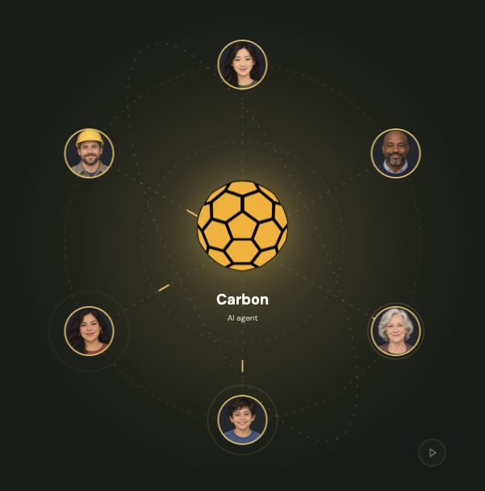
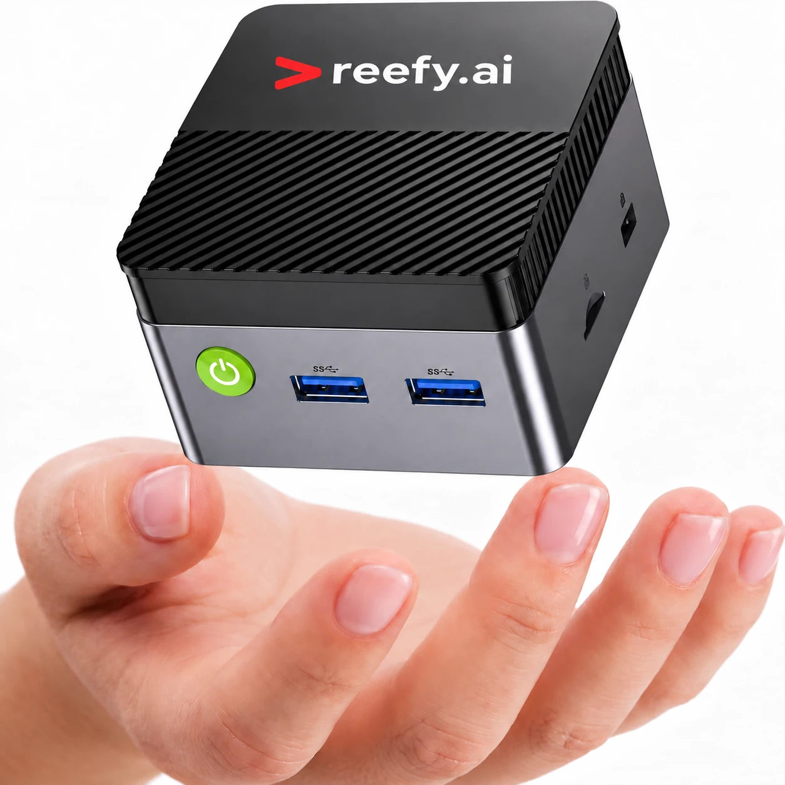

# Carbon — Multiplayer AI

One AI agent. Multiple people. Shared context.

Carbon is an LLM-powered agent that works with multiple people’s data and messages. Think OpenClaw or Meta Muse, with multiple people able to talk to the same agent.

At the [Miami AI Hackathon](https://luma.com/aihackathon26) on **October 17, 2026**, we’re building Carbon and exploring what multiplayer AI can do for communities, families and businesses.

## Run it on a local mini-PC

Carbon runs on a local mini-PC powered by [Reefy OS](https://reefy.ai), with SSH, Docker, Tailscale and LLMs ready for hacking.

A mini-PC will be provided at the hackathon—there’s no need to buy one. The event page also links to a [mini-PC listed at $229](https://a.co/d/08CMx102).

## What can I do at the hackathon?

Pick a stream that interests you. No prior skills are needed—we’ll learn together.

### Core features

- **Telegram:** add another messaging channel alongside WhatsApp.
- **Email transport:** let people send requests and receive replies by email.
- **LLM subscriptions:** add web sign-in for model subscriptions alongside API access.
- **Mixture of Models:** explore how combining different models could lower running costs.
- **Device benchmarks:** measure memory, CPU and disk use to help Carbon run on smaller devices.

### Marketing

- **Launch story:** make a launch video and prepare Hacker News, Reddit and Product Hunt posts.
- **Social outreach:** write X posts and explore influencer outreach.
- **Investor outreach:** introduce Carbon’s vision and explain what we’re building.

### Use cases

- **Everyday journeys:** build and demonstrate ways Carbon could help communities, families and businesses.
- **Broken AC demo:** find local AC professionals, compare quotes and arrange an appointment authorized by the resident.

## What else could Carbon do?

### Communities & cities

- **“My AC is broken.”** Find trusted local professionals using profiles and resident feedback, negotiate quotes and book a visit.
- **Community knowledge:** answer parking, insurance and permit questions from HOA documents, and schedule visits within community rules.

### Families

- **Shared family context:** coordinate children’s schedules and family goals, track learning and explore colleges around each child’s interests.
- **Less household admin:** organize medical appointments, insurance and bills while keeping sensitive information private.

### Businesses

- **Service without lost context:** carry customer requests across specialists while preserving the history and knowledge needed at each handoff.
- **Knowledge at the right level:** keep leadership information confidential while giving interns useful, approved runbooks.
- **Customer agents are coming:** help businesses handle requests from agents such as Muse.

## Technical documentation

For architecture, diagrams, permissions, storage and implementation details, see the [technical guide](docs/technical-guide.md).

- [Deployment and configuration](docs/deployment.md)
- [Current implementation status](docs/implementation-status.md)
- [Testing and E2E coverage](docs/testing.md)
