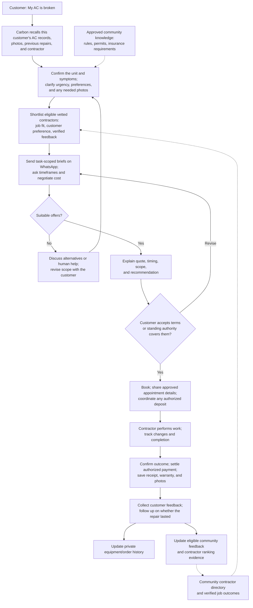

# First configuration example: Aventura Bay service coordination

This is an example configuration for the domain-neutral Carbon harness. Terms such as contractor, equipment, quote, vetting, and repair order belong to bundle content and workflow notes; they are not required core Rust types or built-in tools. The design below is proposed, not deployed. “Quoting workflow/policy” here means bundle instructions plus generic coordination-scope configuration; it introduces no business state machine, contractor type, intent classifier or service-specific permission handler in Rust. No real participant records or community documents are included.

Two independently evolving live bundles are proposed, initially empty and populated by authorized participants through WhatsApp: `aventura-bay-service-coordination` (instructions, participant profiles, and feedback evidence) and `aventura-bay-reference` (approved rules and supporting documents). Participants/groups, access grants, and outbound authority are managed through backend-validated WhatsApp administration commands by authorized participants. Resource text cannot change these records. Bundle contents cannot grant their own access.

## Example customer journey

**Carbon is a community service coordinator that takes a customer from “I need help” to a completed job—and remembers what happened for next time.** Customers and vetted contractors talk to Carbon through WhatsApp. The domain-neutral Carbon backend provides transport, storage, model calls, permission checks, and scheduling.

The first services are air conditioning/HVAC, plumbing, painting, and similar community needs. Carbon combines private customer history, shared community guidance, and a directory of vetted contractors with verified customer feedback.

### A typical journey: “My AC is broken”



For a returning customer, Carbon might show the previous AC photo and ask: “Is this the unit? Is it a similar problem? Should we contact your last contractor first?” For a new customer or new appliance, it creates the record from confirmed details and newly supplied media.

A recommendation should explain *why this contractor suits this job*: relevant experience, verified feedback and its sample size, the customer's previous experience, quoted timeframe, and comparable total cost. “Best” depends on the request; a fast emergency responder may differ from the best fit for a planned renovation.

**Initial scope:** customer/equipment memory, community guidance, vetted contractor discovery and ranking, outbound outreach, task-scoped briefs, negotiation, booking, payments, completion tracking, and feedback. Carbon works within recorded customer authority and offers human help when it cannot resolve the request. This repository remains a plan, not an implemented service.

## Order coordination

1. **Recall and clarify.** For “my AC is broken,” retrieve that customer's AC assets, previous photos, symptoms, work performed, and contractors. Show the relevant photo and ask: “Is this the AC? Is it a similar problem? Should we contact your last contractor first?” Confirm the match rather than assuming every AC problem is the same.
2. **Prepare a request.** Capture symptoms, urgency, equipment and useful timeframe/preferences; request photos or factual details only when needed. The request starts the configured quoting workflow, whose policy already covers routine outreach and reply sharing. Do not ask for outreach permission or brief approval. Check applicable community rules and permit/insurance requirements.
3. **Select contractors.** Start with the previous contractor when requested and still vetted; otherwise use the community's vetted list by trade, service area, current eligibility, and relevant verified feedback, using the directory/ranking policy below. Store who vetted each contractor, evidence, review dates, insurance expiry, and active/suspended status.
4. **Reach out on WhatsApp.** Carbon identifies itself as the coordinating assistant. Send a task-scoped request with an opaque inquiry reference, relevant current-inquiry details/photos and configured approximate service area to selected eligible providers. The workflow policy covers this use of job inputs; no media-by-media approval. Exclude identity-store phone/account details, stored exact addresses and unrelated private history. Do not claim arbitrary supplied text/photos are guaranteed anonymous.
5. **Negotiate.** Ask about earliest inspection and completion dates, call-out fees, labor/materials/taxes, quote exclusions, warranty, and price validity. Negotiate within the customer's recorded limits; distinguish an estimate from a firm quote. Do not invent competing offers or claim acceptance prematurely.
6. **Compare and book.** Present comparable offers and tradeoffs. Record customer authorization for the chosen contractor, scope, price/ceiling, time, cancellation terms, and any deposit before making a binding booking. Explicit standing authorization may cover these actions when its limits are clear.
7. **Pay and close.** Support invoices, deposits, final payments, receipts, cancellation/refund tracking, and completion photos. Proposed MVP: provider-hosted checkout/payment links with verified provider events; Carbon stores references and status, not card details. Provider, settlement model, and supported regions remain decisions to make. A chat claim or screenshot alone does not establish payment.
8. **Remember and learn.** Link the completed order, diagnosis, work, costs, warranty, contractor, and before/after media to the customer's equipment. Collect verified feedback and update the contractor's eligible performance evidence for future recommendations.

The bundle can instruct the model to maintain a structured progress note with states such as: draft → clarifying → sourcing → negotiating → awaiting acceptance → booked → in progress → completed, with cancellation/failure paths. Quote and job progress are bundle-level records. Message delivery remains a core transport concern. Any future payment integration requires a separately reviewed executable adapter; Markdown instructions cannot execute or verify payments. Keep a durable audit of approvals and external actions, prevent duplicate bookings/payments on retries, and provide a human escalation path.

### Default quoting journey: no permission questions

The customer's request is enough to start. There is no separate step to agree a brief, approve recipients, authorize sharing or ask an administrator.

Example:

> Customer: My AC is broken.
>
> Carbon: Is it not cooling, not turning on, or leaking? Send a photo of the unit if you can.
>
> Customer: It runs but doesn't cool. [photo]
>
> Carbon contacts eligible providers, handles questions and follows up under the configured policy.
>
> Carbon: Here are the available quotes and timeframes.

The exact factual questions depend on what Carbon already knows; do not force a questionnaire or ask for budget/photos when unnecessary. Private history can help Carbon ask “is this the same unit?” in the customer conversation, but does not automatically enter the provider brief.

### Automatic input and reply audiences

Protected setup defines a generic workflow policy: current-inquiry inputs can be used with selected enrolled eligible recipients, and their correlated replies return to the requester. Rust creates those resource/context relationships automatically when the customer starts the workflow. The LLM proposes recipients and drafts within the policy; it cannot expand its recipient set, read unrelated data into outgoing context or create privileges through text.

Fresh job details/photos supplied in that context are usable for obtaining quotes without approval of every derived summary or message. Unrelated past records, private notes and account metadata stay outside provider-facing context. If current evidence is missing, ask a factual question or request a fresh photo. Do not reframe this as “may I share your old photo?” or a required permission agreement.

Provider participation is configured before the routine journey, so relaying a quote does not require asking the customer or provider again. Use verified sender plus inquiry/message correlation; when multiple inquiries are possible, ask which job the reply concerns. A provider's reply is visible to its requester, not competing providers or other customers merely because they use the same provider. The eligible provider pool is not a blanket read grant to inquiry material.

If a needed action is unsupported by the configured policy, explain the task limitation and use permitted alternatives. Do not automatically start ACL administration. Customer choices about accepting an offer, booking or paying remain separate from gathering quotes; they do not add an administrator 2PR step.

No per-order administrative groups, brief approval, forwarding confirmations, hidden permission questions or automatic admin escalations. The first request must work without previously created per-inquiry grants.

### WhatsApp outbound constraints

Contractor vetting and messaging consent are separate records. Store consent scope/time/source and opt-outs. The selected native linked-device pilot uses explicitly admitted contacts, backend-controlled recipient allowlists/delegations and bounded follow-ups; cancel pending nonessential outreach after opt-out. It does not expose Cloud API template machinery. Validate the applicable account/product rules before rollout.

For a future official Cloud API adapter, enforce its recipient-specific templates and customer-service windows; re-check the [WhatsApp Business Messaging Policy](https://whatsappbusiness.com/policy/) and API requirements at integration time. Do not carry those mechanics into the native adapter as if they were implemented there, or assume redaction alone establishes permission to share.

## Vetted contractor directory and customer feedback

**Maintain a community-specific directory backed by real job evidence.** Vetting answers “is this contractor eligible?”; feedback answers “how has this contractor performed?”; recommendation answers “how well do they fit this request?” Keep these distinct.

### Directory and vetting

Store a stable contractor organization ID, authorized contacts/WhatsApp opt-ins, trades and specialties, service areas, equipment expertise, and community memberships. Each community records its own status: nominated → under review → vetted, with expired/suspended/removed paths. Record reviewer, evidence, review date, expiry, and applicable insurance/license/permit requirements. A resident recommendation nominates a contractor; it does not automatically vet them.

Keep organization and individual crew/technician identifiers where known, so a business's history is not silently attributed to an unrelated new crew. Availability and quotes are timestamped responses, not permanent profile facts.

### Collect feedback tied to actual work

After each finished job, ask the authenticated customer a short WhatsApp survey:

- Was the agreed problem resolved?
- How was the workmanship?
- Did the contractor arrive when agreed and communicate changes?
- Did the final bill match the agreed scope/price, accounting for approved changes?
- Would you hire them again? Optional comment and supporting photo.

Allow “not applicable” and skipped questions. Ask a later, service-appropriate follow-up about durability; link it to the same review instead of counting another independent job. Invite feedback consistently, including after problems; do not solicit only positive reviews. Record cancellations and no-shows as separate service outcomes without pretending completed-work quality was observed.

A **verified Carbon job review** is an intended evidence-backed classification, not a label the model may self-assign. Until a reviewed verification capability exists, use an attributed human attestation with its evidence and describe it as such. A verified review must reference a real order, the customer, and the contractor, with work/completion evidence. A payment event alone is insufficient. One active review per customer/order/contractor is a desired invariant that needs a reviewed uniqueness constraint/workflow before it is promised; an editable Markdown field cannot enforce it. Keep versioned edits. One authorized household reviewer represents the order unless an explicit aggregation policy says otherwise.

Accept historical community recommendations separately, with provenance and verification level: verified Carbon job, evidence-reviewed external job, or unverified recommendation. Do not mix these into one indistinguishable star average. Optional external review platforms can provide context later, but their ratings remain separately labeled.

### Rank for the job, with visible evidence

Proposed initial ranking policy:

1. **Eligibility assessment:** correct trade/service area, community vetting current, required documents valid, no active suspension, and permission for WhatsApp outreach. The model reasons from these records; its assessment is advisory. The hard outreach boundary is an explicitly administered generic participant allowlist and delegation checked by Rust at dispatch. If expiry/suspension must mechanically disable contact, reflect it in that backend authority through a reviewed operation; changing a Markdown field alone cannot establish or revoke capability.
2. **Customer constraints and preferences:** required timeframe, budget, relevant equipment/specialty, and explicit “last contractor first” preference. Confirm actual availability through outreach; never infer it from old jobs.
3. **Relevant performance:** compare verified outcomes for similar work, workmanship, reliability, communication, and price adherence. Keep approved scope changes separate from unexplained overruns. Display review/job counts, distinct-customer counts, dates, and confidence.
4. **Offer comparison:** after replies, compare current scope, total price, exclusions, warranty, and timing. Present a small shortlist with reasons rather than one unexplained global score.

Avoid ranking a contractor with one five-star job above a consistently strong contractor solely on the raw average. For each rating dimension, a possible transparent estimate is:

```text
adjusted_rating = (n * contractor_mean + m * comparison_group_mean) / (n + m)
```

Here, `n` is the eligible review count; `m` is a documented prior strength, chosen and tested before launch; the comparison group is relevant trade/community data when sufficiently populated. This is a proposed small-sample adjustment, not a finalized scoring formula or proof of quality. Show the raw average/count too. When data is sparse, label confidence as limited instead of manufacturing precision. Missing feedback is unknown, not zero.

Start with explicit filters and separate dimensions rather than arbitrary hidden weights. Show recent trends alongside historical performance, keep service types distinct, and report repeat-customer concentration. Give newly vetted contractors a visible “limited history” position among suitable options so lack of past Carbon work does not permanently exclude them. Track which contractors were shown/contacted to detect a self-reinforcing ranking loop.

### Trust, moderation, and visibility

Keep private feedback separate from community-visible reviews. Ask permission before publishing comments or photos; publish only an approved redacted version, without customer contact details, address, or private order history. Internal aggregate-use permissions and publication preferences are separate.

Preserve source evidence and edit/moderation history. Customers can correct reviews; contractors can respond or dispute factual errors. A dispute alone does not delete criticism or make it proven misconduct. Apply documented moderation criteria consistently, disclose conflicts/incentives, and investigate duplicate or fabricated jobs. Serious complaints enter a documented human review/suspension process; the model does not independently declare allegations established.

Carbon may summarize real feedback with source links and sample sizes. It must not invent reviews, convert inferred sentiment into a customer star rating, or generate unsupported claims such as “the community's best plumber.”

### Storage and audit

Store profiles, vetting evidence, review records, and recommendation explanations as typed-content resources with generic owner, group, version, and source metadata. The initial harness does not need contractor/review/order database tables. Bundle prompts can describe a consistent Markdown/frontmatter or JSON schema; schema checking validates shape, not the truth of a vetting decision.

Free-text negotiation cannot deterministically guarantee that the model never implies a commitment. When such a guarantee is required, use exact participant-approved messages or a separately reviewed structured commitment capability. Prompts and a budget note alone are not an enforcement boundary.

The LLM can propose a shortlist using accessible evidence and explain its reasons. Generic permission checks never depend on its ranking. Specialized scoring or booking/payment functions should be added only when a concrete need warrants a separately reviewed application capability. Store recommendation inputs and output versions for later inspection.

All example sharing uses the core recipient-read rule. Private feedback becomes community-readable only through an explicit authorized publication/grant; the model cannot broaden its audience.
